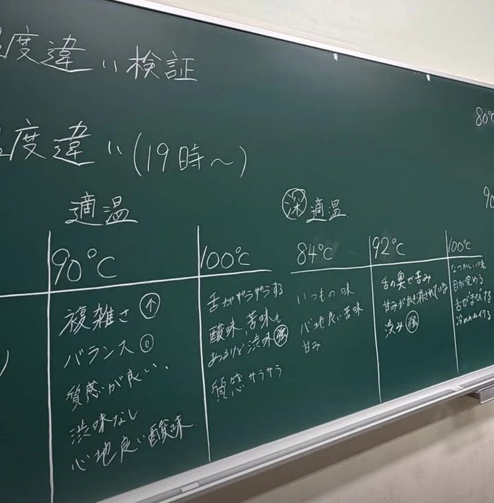

ドリップ練習を行いました☕ [@coffee_of_dainari](https://www.instagram.com/coffee_of_dainari/) さんよりいただいたコロンビア クリーミーウォッシュト。

淹れたてはクリームのような甘さ、時間が経つとショートケーキのような味わいに🍰 とても興味深いコーヒーでした！ありがとうございます😊

## 湯温違い・挽き目違いの検証

湯温違い・挽き目違いの検証を行いました！これらの変数でどう味が変わるかを実践的に学びました✨

過抽出・未抽出や、複雑な味といった、珈琲のレシピを考える際に重要なことを理解するいい機会となりました👌
